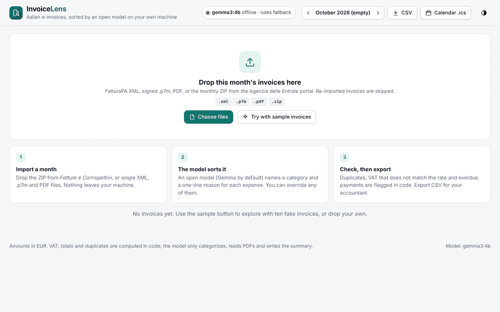
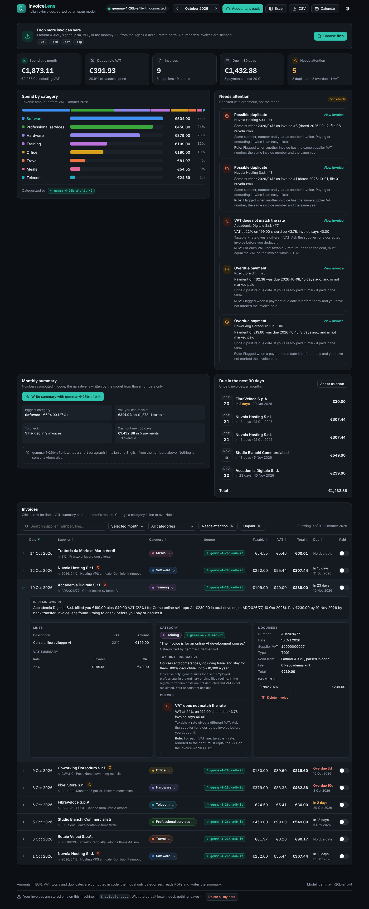
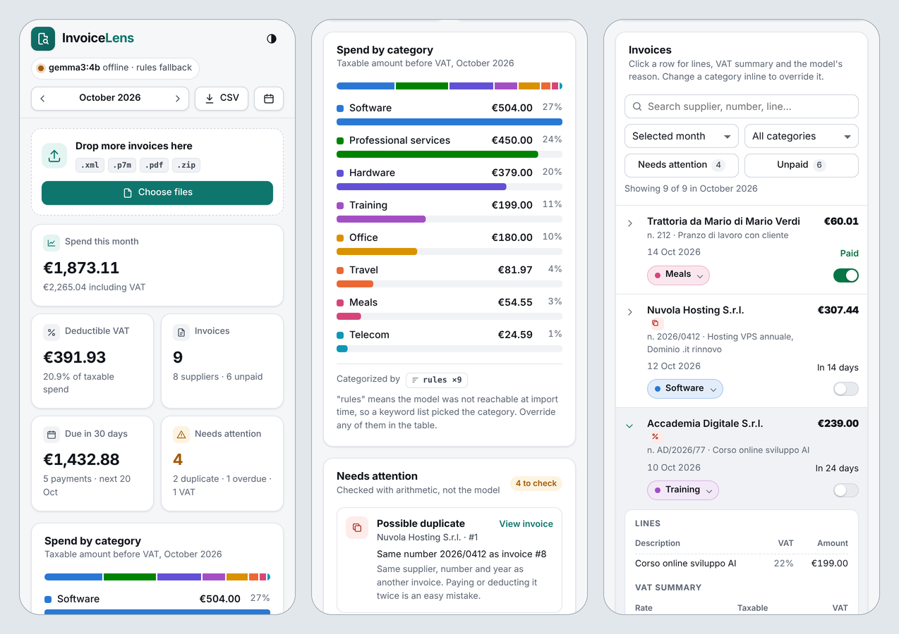
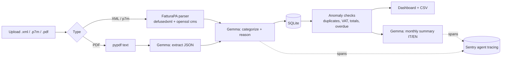

# InvoiceLens

**Your Italian e-invoices, sorted by an open model that never leaves your machine.**

Every Italian freelancer receives dozens of *fatture elettroniche* a month as FatturaPA XML (often wrapped in signed `.p7m` files) plus the odd PDF. InvoiceLens reads them, categorizes each expense with **Gemma running locally**, flags what needs a second look, and gives you a monthly picture you can hand to your accountant.



## What it does

- **Imports a whole month at once**: drop the `.zip` you download from the Agenzia delle Entrate *Fatture e Corrispettivi* portal. SDI receipts are skipped, and invoices you already imported are not added twice.
- **Reads FatturaPA XML and signed `.p7m`** (DER or base64) deterministically: supplier, VAT number, lines, VAT summary, payment terms. Multiple invoices in one file are supported.
- **Reads PDF invoices** by extracting the text and asking the model to fill a fixed JSON schema (it is told never to invent values).
- **Categorizes every expense** (software, travel, professional services...) with an open-weight model, with a one-line reason you can see and override.
- **Flags anomalies** with plain arithmetic, not the model: duplicate invoices, VAT that does not match the rate, totals that do not add up, overdue payments. Each flag shows the exact numbers and the rule that raised it.
- **Accountant pack**: one ZIP per month for the *commercialista*, in Italian: a printable summary (open it and print to PDF), an Excel workbook (summary by category, every invoice, what to check and the rule used), the same data as CSV, and the unpaid due dates as `.ics`. Built in code, no model call.
- **In plain words**: each invoice explained in two or three sentences (who billed what, how much, when and how to pay, what to check), built from the parsed fields.
- **Indicative deductibility hints** per category (for example telecom 80% with 50% of the VAT, meals 75%), clearly marked as general rules for the ordinary regime that do not apply to the *regime forfettario*. Your accountant decides.
- **Dashboard**: monthly spend by category, deductible VAT, payments due in the next 30 days, and a "needs attention" panel that explains each flag and why it matters.
- **Review in place**: search, filter (category, needs attention, unpaid) and sort the invoice table; expand a row to see its lines, VAT summary, payments and the model's one-line reason; change a category inline (saved as `manual`) and mark invoices paid.
- **Honest model status**: a header badge shows whether the model endpoint answers or the app is running on the keyword fallback, and every category says where it came from (the model's name, `rules` or `manual`).
- **Monthly summary** written by the model in Italian and English, from the computed numbers only. The key numbers are shown even when the model is offline.
- **Calendar reminders**: export unpaid due dates as an `.ics` file with a reminder two days before.
- **CSV export** that opens directly in Italian-locale spreadsheets (`;` separator, decimal comma). Text that looks like a spreadsheet formula is neutralized in CSV and Excel exports.
- **Your data stays yours**: invoices live in one local SQLite file, shown in the footer; "Delete all my data" removes every invoice and compacts the file so nothing can be recovered from it.

## The interface

One page, no build step, no external scripts. Drag files anywhere on the page; each file gets its own result (stored, duplicate skipped, or the reason it failed). Light and dark themes follow the system setting (or the toggle in the header), and the layout works down to phone width.


<details>
<summary>Dark mode and phone layout</summary>





</details>

These screenshots were taken with the model endpoint switched off, so every category is labelled `rules` (the keyword fallback). With Gemma running, the same column shows the model's name and its reason.

## Why local and open

Invoices contain client names, prices and tax IDs. Sending them to a closed API is a hard sell for freelancers and accountants. With an open-weight model:

- the data stays on your laptop (default setup: Gemma on Ollama),
- there is no per-invoice cost,
- you can swap the model, or fine-tune it on your own categories, without changing the app.

The arithmetic that matters (VAT, totals, duplicates) is done in code, so the model only does what models are good at: reading messy text and naming things.

## Quickstart (fully local, 2 minutes)

```bash
docker compose up -d
docker compose exec ollama ollama pull gemma3:4b
open http://localhost:8000
```

Click **Try with sample invoices** (it appears while InvoiceLens is empty) to load the ten fake invoices in [`samples/`](samples), or drop your own files.

### Without Docker

```bash
ollama pull gemma3:4b          # https://ollama.com
pip install -r requirements.txt
uvicorn app.main:app --reload
```

## Configuration

| Variable | Default | Meaning |
|---|---|---|
| `LLM_BASE_URL` | `http://localhost:11434/v1` | Any OpenAI-compatible endpoint (Ollama, llama.cpp server, vLLM, a hosted Gemma) |
| `LLM_MODEL` | `gemma3:4b` | Model name at that endpoint |
| `LLM_API_KEY` | `ollama` | Key for hosted endpoints |
| `LLM_TIMEOUT` | `300` | Seconds to wait for one model reply (a 4B model on a laptop CPU takes 20-40 s per invoice); a timed-out call is retried once |
| `LLM_WARMUP` | `1` | Load the model in the background at startup, so the first invoice does not wait for it |
| `INVOICELENS_DB` | `invoicelens.db` | SQLite file |
| `SENTRY_DSN` | unset | When set, every model call is traced as a Sentry `gen_ai.chat` span (model, task, token usage) |
| `INVOICELENS_DEMO` | unset | `1` = public demo: loads the sample invoices, disables uploads and deletes |

If the model endpoint is not reachable, invoices are still parsed and checked; categories fall back to a keyword list and are labelled `rules` in the UI.

## Architecture



## API

| Method | Path | What it does |
|---|---|---|
| `POST` | `/api/invoices` | Upload files (`files` form field). Returns `stored`, `skipped` (already imported) and `errors` |
| `GET` | `/api/invoices` | All invoices with their anomalies |
| `PATCH` | `/api/invoices/{id}` | `{"category": "...", "paid": true}`, either or both; a category set here is stored with source `manual` |
| `DELETE` | `/api/invoices/{id}` | Remove one invoice (not in the public demo) |
| `GET` | `/api/dashboard?month=YYYY-MM` | Month totals, spend by category, upcoming payments, anomalies |
| `GET` | `/api/summary?month=YYYY-MM` | Model-written summary in Italian and English (503 if the model is offline) |
| `GET` | `/api/config` | Model name, whether its endpoint answers (cached `GET /models`), demo flags |
| `GET` | `/api/export.csv`, `/api/deadlines.ics` | Exports |
| `GET` | `/api/accountant-pack.zip?month=YYYY-MM` | Summary (HTML, print to PDF), Excel, CSV, checks and `.ics` in one ZIP |
| `GET` | `/api/report.xlsx?month=YYYY-MM` | The month as an Excel workbook |
| `POST` | `/api/wipe` | `{"confirm": "DELETE"}` deletes every invoice and vacuums the database (not in the public demo) |
| `POST` | `/api/demo/load-samples` | Load the sample invoices: always in the demo, only into an empty store otherwise |

## Deploy the public demo on Render

`render.yaml` deploys a demo with the sample invoices only (uploads are disabled so nobody uploads real data to a shared server). Point `LLM_BASE_URL`/`LLM_API_KEY` at an OpenAI-compatible endpoint serving Gemma, for example Google AI Studio's OpenAI-compatible API with `gemma-3-27b-it`.

## Tests

```bash
pip install -r requirements-dev.txt
pytest
```

The tests cover the XML parser, signed `.p7m` extraction (they sign a sample with a throwaway certificate), entity-expansion protection, anomaly rules, the model request format, and the HTTP API (uploads and duplicate reporting, ZIP import, category overrides, paid status, deletes, the status check and sample loading), the accountant pack and Excel report, formula neutralization, plain-language explanations and the delete-all endpoint.

## Limits

- Signatures on `.p7m` files are not verified, only unwrapped.
- Credit notes (TD04) are shown as positive amounts.
- PDF extraction needs a text layer; scanned images are rejected.

## License

MIT
