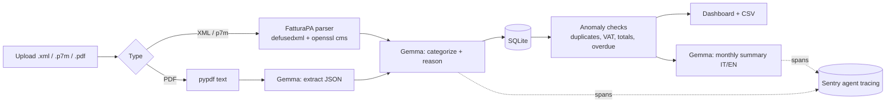

# InvoiceLens

[](https://github.com/carlogiovannifalocco-byte/invoice-lens/actions/workflows/ci.yml)
[](https://github.com/carlogiovannifalocco-byte/invoice-lens/actions/workflows/docker.yml)
[](https://render.com/deploy?repo=https://github.com/carlogiovannifalocco-byte/invoice-lens)

**Your Italian e-invoices, sorted by an open model that never leaves your machine.**

Every Italian freelancer receives dozens of *fatture elettroniche* a month as FatturaPA XML (often wrapped in signed `.p7m` files) plus the odd PDF. InvoiceLens reads them, categorizes each expense with **Gemma running locally**, flags what needs a second look, and gives you a monthly picture you can hand to your accountant.


## What it does

- **Imports a whole month at once**: drop the `.zip` you download from the Agenzia delle Entrate *Fatture e Corrispettivi* portal. SDI receipts are skipped, and invoices you already imported are not added twice.
- **Reads FatturaPA XML and signed `.p7m`** (DER or base64) deterministically: supplier, VAT number, lines, VAT summary, payment terms. Multiple invoices in one file are supported.
- **Reads PDF invoices** by extracting the text and asking the model to fill a fixed JSON schema (it is told never to invent values).
- **Categorizes every expense** (software, travel, professional services...) with an open-weight model, with a one-line reason you can see and override.
- **Flags anomalies** with plain arithmetic, not the model: duplicate invoices, VAT that does not match the rate, totals that do not add up, overdue payments. Each flag shows the exact numbers and the rule that raised it.
- **Accountant pack**: one ZIP per month for the *commercialista*, in Italian: a printable summary (open it and print to PDF), an Excel workbook (summary by category, every invoice, what to check and the rule used), the same data as CSV, and the unpaid due dates as `.ics`. Built in code, no model call.
- **In plain words**: each invoice explained in two or three sentences (who billed what, how much, when and how to pay, what to check), built from the parsed fields.
- **Indicative deductibility hints** per category (for example telecom 80% with 50% of the VAT, meals 75%), clearly marked as general rules for the ordinary regime that do not apply to the *regime forfettario*. Your accountant decides.
- **Dashboard**: monthly spend by category, deductible VAT, payments due in the next 30 days, and a "needs attention" panel that explains each flag and why it matters.
- **Review in place**: search, filter (category, needs attention, unpaid) and sort the invoice table; expand a row to see its lines, VAT summary, payments and the model's one-line reason; change a category inline (saved as `manual`) and mark invoices paid.
- **Honest model status**: a header badge shows whether the model endpoint answers or the app is running on the keyword fallback, and every category says where it came from (the model's name, `rules` or `manual`).
- **Monthly summary** written by the model in Italian and English, from the computed numbers only. The key numbers are shown even when the model is offline.
- **Calendar reminders**: export unpaid due dates as an `.ics` file with a reminder two days before.
- **CSV export** that opens directly in Italian-locale spreadsheets (`;` separator, decimal comma). Text that looks like a spreadsheet formula is neutralized in CSV and Excel exports.
- **Your data stays yours**: invoices live in one local SQLite file, shown in the footer; "Delete all my data" removes every invoice and compacts the file so nothing can be recovered from it.

## The interface

One page, no build step, no external scripts. Drag files anywhere on the page; each file gets its own result (stored, duplicate skipped, or the reason it failed). Light and dark themes follow the system setting (or the toggle in the header), and the layout works down to phone width.


<details>
<summary>Dark mode and phone layout</summary>


</details>

These screenshots were taken with the model endpoint switched off, so every category is labelled `rules` (the keyword fallback). With Gemma running, the same column shows the model's name and its reason.

## Why local and open

Invoices contain client names, prices and tax IDs. Sending them to a closed API is a hard sell for freelancers and accountants. With an open-weight model:

- the data stays on your laptop (default setup: Gemma on Ollama),
- there is no per-invoice cost,
- you can swap the model, or fine-tune it on your own categories, without changing the app.

The arithmetic that matters (VAT, totals, duplicates) is done in code, so the model only does what models are good at: reading messy text and naming things.

## Quickstart (fully local, 2 minutes)

```bash
docker compose up -d
docker compose exec ollama ollama pull gemma3:4b
open http://localhost:8000
```

Click **Try with sample invoices** (it appears while InvoiceLens is empty) to load the ten fake invoices in [`samples/`](samples), or drop your own files.

### Without Docker

```bash
ollama pull gemma3:4b          # https://ollama.com
pip install -r requirements.txt
uvicorn app.main:app --reload
```

## Configuration

| Variable | Default | Meaning |
|---|---|---|
| `LLM_BASE_URL` | `http://localhost:11434/v1` | Any OpenAI-compatible endpoint (Ollama, llama.cpp server, vLLM, a hosted Gemma) |
| `LLM_MODEL` | `gemma3:4b` | Model name at that endpoint |
| `LLM_API_KEY` | `ollama` | Key for hosted endpoints |
| `LLM_TIMEOUT` | `300` | Seconds to wait for one model reply (a 4B model on a laptop CPU takes 20-40 s per invoice); a timed-out call is retried once |
| `LLM_JSON_MODE` | `1` | `0` = do not send `response_format: json_object` (for endpoints that refuse JSON mode) |
| `LLM_SYSTEM_AS_USER` | `0` | `1` = put the system prompt at the top of the user message (for endpoints that refuse the system role) |
| `LLM_MIN_INTERVAL` | `0` | Minimum seconds between two model calls, to stay under a free tier's requests-per-minute limit |
| `LLM_PROVIDER` | guessed | Provider name reported to Sentry (`gcp.gemini`, `ollama`, `openai`...) |
| `LLM_WARMUP` | `1` | Load the model in the background at startup, so the first invoice does not wait for it |
| `INVOICELENS_DB` | `invoicelens.db` | SQLite file |
| `SENTRY_DSN` | unset | When set, imports are traced for Sentry's AI Agents dashboard (see [Tracing with Sentry](#tracing-with-sentry)) |
| `SENTRY_ENVIRONMENT` | `local` | Environment name shown in Sentry (`render-demo` on Render) |
| `SENTRY_SEND_PROMPTS` | unset | `1` = also send prompts and replies to Sentry. Off by default because invoices hold client names and prices |
| `SENTRY_TRACES_SAMPLE_RATE` | `1.0` | Share of requests traced |
| `INVOICELENS_DEMO` | unset | `1` = public demo: preloads the sample invoices, categorizes them in the background, disables uploads and deletes |
| `INVOICELENS_DEMO_PRELOAD` | `1` | `0` = in demo mode, do not load and categorize the samples at start-up |

If an endpoint answers `400` to JSON mode or to the system role (Gemma on some hosted APIs did), InvoiceLens retries the call without that field and remembers it for the next calls, so the two switches above are only needed to skip that first failed request. A `429` is retried after the `Retry-After` delay, at most twice.

If the model endpoint is not reachable, invoices are still parsed and checked; categories fall back to a keyword list and are labelled `rules` in the UI. `POST /api/recategorize` asks the model again for every invoice still labelled `rules` once it is back (manual choices are kept).

## Architecture



## API

| Method | Path | What it does |
|---|---|---|
| `POST` | `/api/invoices` | Upload files (`files` form field). Returns `stored`, `skipped` (already imported) and `errors` |
| `GET` | `/api/invoices` | All invoices with their anomalies |
| `PATCH` | `/api/invoices/{id}` | `{"category": "...", "paid": true}`, either or both; a category set here is stored with source `manual` |
| `DELETE` | `/api/invoices/{id}` | Remove one invoice (not in the public demo) |
| `GET` | `/api/dashboard?month=YYYY-MM` | Month totals, spend by category, upcoming payments, anomalies |
| `GET` | `/api/summary?month=YYYY-MM` | Model-written summary in Italian and English (503 if the model is offline) |
| `GET` | `/api/config` | Model name, whether its endpoint answers (cached `GET /models`), demo flags |
| `GET` | `/api/export.csv`, `/api/deadlines.ics` | Exports |
| `GET` | `/api/accountant-pack.zip?month=YYYY-MM` | Summary (HTML, print to PDF), Excel, CSV, checks and `.ics` in one ZIP |
| `GET` | `/api/report.xlsx?month=YYYY-MM` | The month as an Excel workbook |
| `POST` | `/api/wipe` | `{"confirm": "DELETE"}` deletes every invoice and vacuums the database (not in the public demo) |
| `POST` | `/api/demo/load-samples` | Load the sample invoices: always in the demo, only into an empty store otherwise |
| `POST` | `/api/recategorize` | Ask the model again for invoices labelled `rules`, in the background (progress in `/api/config` under `background`) |
| `GET` | `/healthz` | Liveness check that does not call the model (used by Render) |
| `GET` | `/api/health` | A real round trip to the model |

## Deploy the public demo on Render

[](https://render.com/deploy?repo=https://github.com/carlogiovannifalocco-byte/invoice-lens)

The public demo runs on Render's free plan with **Gemma 4 hosted by Google AI Studio** (the Gemini API's OpenAI-compatible endpoint), so it does not depend on anyone's laptop. [`render.yaml`](render.yaml) sets everything except your API key:

- demo mode: only the ten fake sample invoices, uploads and deletes disabled, so nobody puts real data on a shared server;
- at start-up the samples appear at once (keyword rules), then Gemma recategorizes them in the background, one call every 4 seconds (`LLM_MIN_INTERVAL`) to stay under the free tier's per-minute limit; after about a minute the category column shows `gemma-4-26b-a4b-it` and its reason;
- the monthly summary is cached while the numbers do not change, so visitors clicking the button do not use up the quota;
- health check on `/healthz`, which never calls the model;
- redeploys on every push to `main` once the GitHub Actions checks pass (`autoDeployTrigger: checksPass`).

Step by step:

1. Get a Gemini API key: open [Google AI Studio](https://aistudio.google.com/apikey), sign in, click **Create API key** and copy it. The free tier is enough for the demo; check your model's limits on AI Studio's rate-limit page.
2. Click the **Deploy to Render** button above (or in the [Render dashboard](https://dashboard.render.com): **New** > **Blueprint**, then pick this repository). Sign in with GitHub if asked.
3. Render reads `render.yaml` and shows one service, `invoicelens-demo` (free plan, Docker). Paste the AI Studio key into **LLM_API_KEY**. Leave **SENTRY_DSN** empty, or paste a DSN (see [Tracing with Sentry](#tracing-with-sentry)).
4. Click **Deploy Blueprint**. The first build takes a few minutes; then open the `https://invoicelens-demo-....onrender.com` URL shown on the service page.
5. Check it works: the header badge says the model is reachable, and after about a minute every invoice is categorized by `gemma-4-26b-a4b-it` instead of `rules`.

Free instances sleep after 15 minutes without traffic, and the first visit after that takes about a minute to wake up. The demo database lives in `/tmp`, so every restart reloads and recategorizes the samples (10 model calls). If Gemma 4 is renamed on the Gemini API, change `LLM_MODEL` in the service's **Environment** tab; `GET https://generativelanguage.googleapis.com/v1beta/openai/models` with your key lists the available models.

## Tracing with Sentry

With `SENTRY_DSN` set, every import is traced with Sentry's [AI agent span conventions](https://docs.sentry.io/platforms/python/agent-tracing/manual-instrumentation/), so it shows up in Sentry's **AI Agents** dashboards (agent runs, LLM calls, latency, tokens and estimated cost per model, tool calls and tool errors):

```
invoke_agent InvoiceLens categorizer          gen_ai.invoke_agent   one upload, sample load or recategorization
└── invoice 2026/0412 Nuvola Hosting S.r.l.   function              one per invoice
    ├── execute_tool parse_fatturapa          gen_ai.execute_tool   deterministic XML / .p7m parsing
    ├── execute_tool duplicate_check          gen_ai.execute_tool
    ├── chat gemma-4-26b-a4b-it               gen_ai.chat           model, provider, input/output tokens, latency
    ├── execute_tool keyword_rules            gen_ai.execute_tool   only when the model failed
    └── execute_tool anomaly_checks           gen_ai.execute_tool   VAT, totals, duplicates, overdue
```

Timeouts, retries and fallbacks are recorded on the span where they happened (`invoicelens.events`, for example `["timeout"]` or `["fallback: retry without json_mode"]`), as breadcrumbs, and a failed model call gets an error status and an `error.type` (`timeout`, `http_429`, `ConnectError`, `invalid_json`). `invoicelens.model_seconds` is the time spent waiting for the model, including retries. Prompts and replies are only sent with `SENTRY_SEND_PROMPTS=1`; the public demo turns it on because it only holds fake invoices.

1. Create a free account at [sentry.io](https://sentry.io/signup/).
2. **Projects** > **Create Project**, choose **Python** (or FastAPI), name it `invoicelens`.
3. Copy the **DSN** it shows (also under **Settings** > **Projects** > `invoicelens` > **Client Keys (DSN)**).
4. Set it where InvoiceLens runs: `SENTRY_DSN=... uvicorn app.main:app` locally, or the `SENTRY_DSN` variable in the Render service's **Environment** tab. Optionally set `SENTRY_ENVIRONMENT`.
5. Import a few invoices (or open the demo, which categorizes the samples at start-up).
6. In Sentry open **Dashboards** and pick the prebuilt **AI Agents** dashboard (in some accounts it is under **Insights** > **AI** > **Agents**); open a trace to see the spans above.

Token cost is estimated by Sentry from the model name; Gemma on the free tier or on your own machine costs nothing, so the cost column may stay empty or at zero.

## Continuous integration

GitHub Actions runs on every push and pull request:

- [`ci.yml`](.github/workflows/ci.yml): the test suite on Python 3.12;
- [`docker.yml`](.github/workflows/docker.yml): builds the Docker image, starts it in demo mode and checks that the sample invoices load and the accountant pack downloads; on `main` it pushes the image to `ghcr.io/carlogiovannifalocco-byte/invoice-lens`.

Dependabot keeps the actions, Python packages and base image up to date. Render deploys `main` only after these checks pass.

## Tests

```bash
pip install -r requirements.txt -r requirements-dev.txt
python -m pytest -q
```

The tests cover the XML parser, signed `.p7m` extraction (they sign a sample with a throwaway certificate), entity-expansion protection, anomaly rules, the model request format, and the HTTP API (uploads and duplicate reporting, ZIP import, category overrides, paid status, deletes, the status check and sample loading), the accountant pack and Excel report, formula neutralization, plain-language explanations and the delete-all endpoint. `tests/test_hosted_and_tracing.py` covers the hosted-endpoint fallbacks (JSON mode or system role refused, rate limits, thinking blocks around the JSON), the background recategorization, and the shape of the Sentry agent traces.

## Limits

- Signatures on `.p7m` files are not verified, only unwrapped.
- Credit notes (TD04) are shown as positive amounts.
- PDF extraction needs a text layer; scanned images are rejected.

## License

MIT
