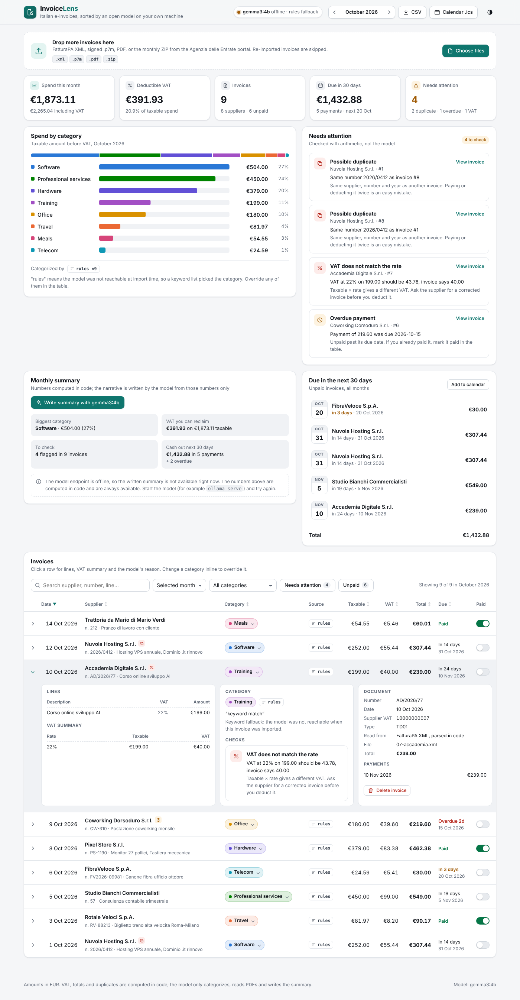
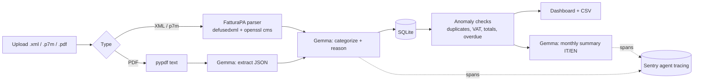

# InvoiceLens

**Your Italian e-invoices, sorted by an open model that never leaves your machine.**

Every Italian freelancer receives dozens of *fatture elettroniche* a month as FatturaPA XML (often wrapped in signed `.p7m` files) plus the odd PDF. InvoiceLens reads them, categorizes each expense with **Gemma running locally**, flags what needs a second look, and gives you a monthly picture you can hand to your accountant.



## What it does

- **Reads FatturaPA XML and signed `.p7m`** (DER or base64) deterministically: supplier, VAT number, lines, VAT summary, payment terms. Multiple invoices in one file are supported.
- **Reads PDF invoices** by extracting the text and asking the model to fill a fixed JSON schema (it is told never to invent values).
- **Categorizes every expense** (software, travel, professional services...) with an open-weight model, with a one-line reason you can see and override.
- **Flags anomalies** with plain arithmetic, not the model: duplicate invoices, VAT that does not match the rate, totals that do not add up, overdue payments.
- **Dashboard**: monthly spend by category, deductible VAT, payments due in the next 30 days.
- **Monthly summary** written by the model in Italian and English, from the computed numbers only.
- **CSV export** that opens directly in Italian-locale spreadsheets (`;` separator, decimal comma).

## Why local and open

Invoices contain client names, prices and tax IDs. Sending them to a closed API is a hard sell for freelancers and accountants. With an open-weight model:

- the data stays on your laptop (default setup: Gemma on Ollama),
- there is no per-invoice cost,
- you can swap the model, or fine-tune it on your own categories, without changing the app.

The arithmetic that matters (VAT, totals, duplicates) is done in code, so the model only does what models are good at: reading messy text and naming things.

## Quickstart (fully local, 2 minutes)

```bash
docker compose up -d
docker compose exec ollama ollama pull gemma3:4b
open http://localhost:8000
```

Drop the files from [`samples/`](samples) (fake invoices) or your own.

### Without Docker

```bash
ollama pull gemma3:4b          # https://ollama.com
pip install -r requirements.txt
uvicorn app.main:app --reload
```

## Configuration

| Variable | Default | Meaning |
|---|---|---|
| `LLM_BASE_URL` | `http://localhost:11434/v1` | Any OpenAI-compatible endpoint (Ollama, llama.cpp server, vLLM, a hosted Gemma) |
| `LLM_MODEL` | `gemma3:4b` | Model name at that endpoint |
| `LLM_API_KEY` | `ollama` | Key for hosted endpoints |
| `INVOICELENS_DB` | `invoicelens.db` | SQLite file |
| `SENTRY_DSN` | unset | When set, every model call is traced as a Sentry `gen_ai.chat` span (model, task, token usage) |
| `INVOICELENS_DEMO` | unset | `1` = public demo: loads the sample invoices, disables uploads |

If the model endpoint is not reachable, invoices are still parsed and checked; categories fall back to a keyword list and are labelled `rules` in the UI.

## Architecture



## Deploy the public demo on Render

`render.yaml` deploys a demo with the sample invoices only (uploads are disabled so nobody uploads real data to a shared server). Point `LLM_BASE_URL`/`LLM_API_KEY` at an OpenAI-compatible endpoint serving Gemma, for example Google AI Studio's OpenAI-compatible API with `gemma-3-27b-it`.

## Tests

```bash
pip install -r requirements-dev.txt
pytest
```

The tests cover the XML parser, signed `.p7m` extraction (they sign a sample with a throwaway certificate), entity-expansion protection, anomaly rules, the model request format, and the HTTP API.

## Limits

- Signatures on `.p7m` files are not verified, only unwrapped.
- Credit notes (TD04) are shown as positive amounts.
- PDF extraction needs a text layer; scanned images are rejected.

## License

MIT
